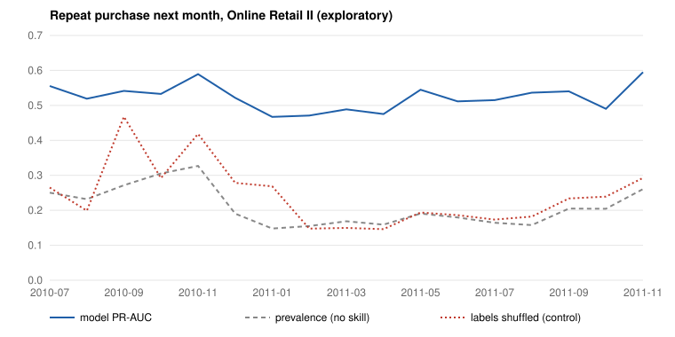

# Sales Representation Pilot

[](https://github.com/rayhansyahrizal/sales-representation-pilot/actions/workflows/tests.yml)

Can you predict who buys again, and what they buy next, from plain transaction logs? This repo tests
that on two public retail datasets, with one unusual rule: **every analysis is written down and frozen
before it is run**, so a good-looking result cannot be produced by trying things until one works.

It is a falsification pilot. The goal is to find out quickly whether an idea is dead, not to make it
look alive.

## Results so far

All results below are **exploratory**: they use data the builder could see. None is a hidden-holdout
or confirmatory result, and nothing here claims causation.

| Question | Dataset | Result |
|---|---|---|
| Does purchase history predict a repeat purchase next month? | Online Retail II | Yes. Logistic PR-AUC 0.595 vs 0.261 prevalence (gain 0.334, 95% customer-bootstrap CI 0.312 to 0.356). |
| Is that signal stable over time? | Online Retail II | Beat prevalence in 17 of 17 monthly cutoffs (Jul 2010 to Nov 2011), median PR-AUC gain 0.320. |
| Is it real, or leakage? | Online Retail II | Shuffling labels removed most of it: gain fell to 0.049 with chance-level ROC-AUC 0.440. |
| Does a simple model beat "most common next step" for browsing behaviour? | Retailrocket | No. Transition accuracy 0.930 vs 0.930 baseline: zero gain. |



The model line stays well above both baselines in every month. The shuffled-label control is noisy in
the first few months (it spikes in Sep and Nov 2010), which is one more reason these results stay
exploratory.

What drives the repeat-purchase signal: recent buying, more previous invoices, and more distinct items
bought before. All three had the same sign in 17 of 17 fits.

## How the work is guarded

- **Preregistration.** Each analysis has a frozen design document and a manifest with SHA-256 hashes
  before it runs (`docs/*-preregistration.md`, `manifests/`).
- **Kill rules decided in advance.** The exploratory baseline had a mechanical PROCEED / STOP rule;
  the Retailrocket half failed it honestly.
- **Leakage-safe episodes.** Features only use information available before each cutoff
  (`docs/feature-availability.md`).
- **A gate that says no.** The modeling gate is currently **REVISE**: confirmatory modeling stays
  blocked until a holdout exists that the builder provably cannot see. A file in this repo cannot prove
  that, so the gate does not pretend it can (`artifacts/gate-report.md`,
  [decision 0001](docs/decisions/0001-no-confirmatory-claims-without-an-unseen-holdout.md)).

## Reproduce

Requires Python 3.11 to 3.13 and [uv](https://docs.astral.sh/uv/).

```bash
uv sync --frozen
uv run python scripts/acquire.py          # downloads the public datasets, checks hashes
uv run python scripts/audit.py            # row-level forensic audit
uv run python scripts/build_exploratory_features.py
uv run python scripts/run_exploratory_baselines.py
uv run python scripts/run_temporal_stability.py
uv run python scripts/run_temporal_sensitivity.py
uv run pytest -q                          # 20 tests
uv run python scripts/plot_temporal_stability.py   # redraws the chart above
```

## Data

| Dataset | Source | License |
|---|---|---|
| Online Retail II | [UCI Machine Learning Repository](https://archive.ics.uci.edu/dataset/502/online+retail+ii), DOI 10.24432/C5CG6D | CC BY 4.0 |
| Retailrocket e-commerce | [Kaggle](https://www.kaggle.com/datasets/retailrocket/ecommerce-dataset) | CC BY-NC-SA 4.0 |

Raw data and derived feature files are **not** in this repo. `acquire.py` and
`build_exploratory_features.py` rebuild them locally. Committed artifacts contain aggregates only.

## Layout

| Path | What it holds |
|---|---|
| `src/sales_representation_audit/` | Audit, episode building, baselines, stability analysis |
| `scripts/` | One entry point per frozen analysis |
| `manifests/` | Sources, checksums and frozen analysis manifests |
| `docs/` | Preregistrations, feature availability, confirmation design |
| `artifacts/` | Machine-readable results and the reports quoted above |
| `docs/decisions/` | Decision records |

## License

Code: [MIT](LICENSE). The datasets keep their own licenses (see above) and are not redistributed here.
